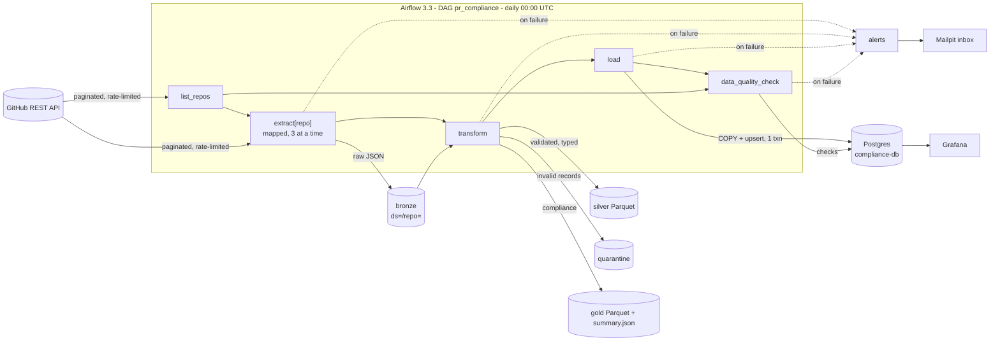

# PR Compliance Pipeline

A daily **Apache Airflow 3.3** pipeline that checks whether merged pull requests in the
[`home-assistant`](https://github.com/home-assistant) GitHub organisation met code-review
standards: **at least one approval** and **all status checks green**. It extracts from the
GitHub REST API, validates and transforms with Pandas, and loads into Postgres, with
alerting, data-quality checks and a Grafana dashboard.

This is the **infra** repo (runtime). The pipeline code lives in
[`pr-compliance-processing`](processing), pinned here as the
`processing/` submodule.

| | |
|---|---|
| Orchestration | Airflow 3.3.0, LocalExecutor, daily at 00:00 UTC |
| Processing | Python 3.13, Pandas, JSON Schema, pandera |
| Storage | Local bronze JSON / silver + gold Parquet |
| Output | Postgres 16 (`pr_compliance`, `compliance_summary`, `etl_runs`, views) |
| Alerts | E-mail to a local Mailpit inbox |
| Dashboard | Grafana 12 (read-only DB role) |

---

## Contents
1. [Quick start](#quick-start)
2. [Architecture](#architecture)
3. [Configuration](#configuration)
4. [The DAG](#the-dag)
5. [Data layout](#data-layout)
6. [Compliance rules and assumptions](#compliance-rules-and-assumptions)
7. [Output tables and querying](#output-tables-and-querying)
8. [Logging](#logging)
9. [Monitoring, alerting and runbook](#monitoring-alerting-and-runbook)
10. [Testing](#testing)
11. [Known limitations and scaling](#known-limitations-and-scaling)
12. [Troubleshooting](#troubleshooting)

---

## Quick start

**Prerequisites:** Docker with Compose v2 (4 GB RAM for Docker), git, make (Linux/macOS,
or Git Bash/WSL on Windows), and a GitHub token. Any classic or fine-grained token works;
it needs **no scopes** because only public data is read. It is required because
unauthenticated access is limited to 60 requests/hour.

```bash
git clone --recursive <this-repo-url> pr-compliance-infra
cd pr-compliance-infra
cp .env.example .env          # then set GITHUB_TOKEN=...
make up                       # builds the image, starts everything, waits until healthy
make demo                     # optional: small run (4 repos, last 7 days) in a few minutes
```

| Service | URL | Login |
|---|---|---|
| Airflow UI | http://localhost:8080 | `airflow` / `airflow` |
| Mailpit (alert inbox) | http://localhost:8025 | – |
| Grafana | http://localhost:3000 | anonymous viewer (admin / admin) |
| Postgres output | `localhost:5433`, db `compliance` | see `.env` |

The DAG is **unpaused on creation**, so the scheduler immediately runs the latest
complete interval (yesterday, UTC) for the whole organisation (~85 repositories, about
8 minutes). Every port is configurable in `.env` (`AIRFLOW_PORT`, `COMPLIANCE_DB_PORT`,
`MAILPIT_PORT`, `GRAFANA_PORT`) if something else already uses it.

Other targets: `make help`, `make trigger`, `make test-alert`, `make test-dag`,
`make psql`, `make logs`, `make down`, `make clean`.

> Cloned without `--recursive`? `make` stops with a clear message; run
> `git submodule update --init`.

---

## Architecture



| Container | Role |
|---|---|
| `airflow-db` | Airflow metadata Postgres (never holds business data) |
| `compliance-db` | Output Postgres; DDL from `processing/sql/init` runs on first start |
| `airflow-init` | DB migration and admin user, then exits |
| `airflow-apiserver` | UI + REST API + task execution API (replaces the Airflow 2 webserver) |
| `airflow-scheduler` | Schedules and runs tasks (LocalExecutor) |
| `airflow-dag-processor` | Parses DAG files (a separate process in Airflow 3) |
| `airflow-triggerer` | Runs the deadline-alert callback |
| `mailpit` | Local SMTP server + web inbox for alert e-mails |
| `grafana` | Provisioned dashboard on the output DB |

**Two repos:** processing owns the code, DAG, schemas and DDL (they change together);
infra owns where it runs and pins processing at a commit. The image installs the package
with `uv` under Airflow's official **constraints-3.3.0 / Python 3.13** file, so shared
libraries match what Airflow was tested with. See the ADRs in
`processing/docs/adr/` and the one-page `processing/docs/APPROACH.md`.

---

## Configuration

Everything is read from `.env` (copied from `.env.example`).

| Variable | Default | Meaning |
|---|---|---|
| `GITHUB_TOKEN` | – (required) | Token for the GitHub API; never logged |
| `GITHUB_ORG` | `home-assistant` | Organisation to scan |
| `REPO_ALLOWLIST` | empty = all | Comma-separated repos (public, non-archived, non-empty are used otherwise) |
| `LOOKBACK_DAYS` | unset | Widen the merge window to N days (demo/backfill) |
| `MAX_PRS_PER_REPO` | `5000` | Safety valve per repo per run (logged when hit) |
| `EXTRACT_MAX_WORKERS` | `8` | Threads per extract task (× 3 mapped tasks) |
| `MIN_APPROVALS` | `1` | Approvals required |
| `NO_CHECKS_PASSES` | `false` | Treat PRs with no checks at all as passing |
| `EXCLUDE_BOTS` | `false` | Drop bot-authored PRs from the output |
| `DQ_FRESHNESS_HOURS` | `48` | Newest merge must be younger than this |
| `DQ_MIN_PRS` | `1` | Minimum PRs per run |
| `DQ_VOLUME_DROP_RATIO` | `0.5` | Fail below 50% of the 7-day average |
| `DQ_MAX_QUARANTINE_RATE` | `0.05` | Fail above 5% invalid records |
| `DQ_MAX_COMPLIANCE_DRIFT_PTS` | `20` | Fail if the rate moves > 20 points vs 7-day average |
| `ALERT_EMAIL_TO` | `data-alerts@example.com` | Alert recipient (lands in Mailpit) |
| `COMPLIANCE_DB_*` | see file | Output DB credentials |

Connections are environment variables, so credentials never sit in code or the metadata
DB: `AIRFLOW_CONN_COMPLIANCE_DB` (Postgres) and `AIRFLOW_CONN_SMTP_ALERTS` (Mailpit).
The GitHub token can alternatively be supplied as the password of a `github_api`
connection.

> Use a DB password that is not an ordinary word: Airflow masks every occurrence of a
> connection password in logs, so a password of `compliance` turns `pr_compliance` into
> `pr_***` everywhere.

---

## The DAG

`pr_compliance` — schedule `CronDataIntervalTimetable("0 0 * * *", UTC)`, `catchup=False`,
`max_active_runs=1`, 2 retries with exponential backoff, failure and retry callbacks, and
a deadline alert.

| Task | What it does | Output (XCom) |
|---|---|---|
| `list_repos` | Public, non-archived, non-empty repos of the org (or the allowlist) | list of names |
| `extract[repo]` | Dynamically mapped, max 3 at a time. Merged PRs in the window plus reviews, commits, combined status and check runs per PR → bronze | partition path |
| `transform` | bronze → silver (JSON Schema validation, quarantine) → gold (rules, summary). Uses only partitions written by this run. Trigger rule `all_done_min_one_success`: failed repos are tolerated, a run that extracted nothing is not | gold paths |
| `load` | gold → Postgres in one transaction: upsert, then remove rows of this run's scope no longer in gold; declares an `Asset` outlet | inserted / updated / deleted |
| `data_quality_check` | Completeness, quarantine rate, volume, drift, freshness, integrity; fails the run on any breach | check results |

**Window.** Each run processes PRs with `merged_at` in its data interval — the previous
UTC day. "12:00 AM" is read as **midnight UTC** (switching to `Africa/Johannesburg` is a
one-line change). Airflow 3 turns a plain cron string into a `CronTriggerTimetable`
whose data interval has zero length, which is why the interval timetable is explicit.
Manual triggers have no data interval in Airflow 3; they process the last full UTC day
before they were created.

**Reruns and backfills.** A run owns its `ds` partition on disk and, in Postgres, the
slice *repos it extracted × its merge window* (`gold/…/load_scope.json`). A rerun
overwrites the same files, upserts the same rows and deletes rows of that slice that are
no longer produced, so a narrower rerun leaves no orphans, while repos that failed
extraction keep their earlier rows. `make demo` (a manual trigger) writes the same `ds`
as yesterday's scheduled run; rerun the scheduled run afterwards for full data. History: `airflow backfill create --dag-id
pr_compliance --from-date 2026-11-01 --to-date 2026-11-20` (inside the scheduler
container).

**Failure behaviour.**

| What fails | What happens |
|---|---|
| GitHub 5xx / 429 / secondary limit / timeout | Retried inside the client (exponential backoff with jitter, `Retry-After` honoured, 5 attempts) |
| Primary rate limit low | Client sleeps until `X-RateLimit-Reset` (logged as `rate_limit_wait`); gives up if the reset is > 65 min away |
| One PR resource 404/409/422 | Skipped and recorded in the manifest; the PR is kept |
| A whole repo (404, 401, bad config) | `AirflowFailException` — no pointless retries; e-mail alert; other repos continue; DQ fails the run |
| Task crashes mid-extract | The repo's bronze partition is staged and swapped atomically, so the previous one stays intact; the retry rewrites it |
| Load error | Transaction rolled back, nothing partial; rerun `load` alone |
| Run late (not finished by 03:00 UTC next day) | Deadline alert e-mail (also catches a dead scheduler) |

---

## Data layout

```
data/
├── bronze/ds=2026-11-23/repo=core/      raw API responses, exactly as returned
│   ├── pull_requests.json               list of PR objects
│   ├── reviews.json  commits.json  statuses.json  check_runs.json   {"<pr_number>": payload}
│   └── _manifest.json                   run_id, window, counts, skipped PRs, API calls, timing
├── quarantine/ds=2026-11-23/<entity>.jsonl   records that failed schema validation + errors
├── silver/ds=2026-11-23/<entity>.parquet     validated, typed, flattened; _stats.json
└── gold/ds=2026-11-23/
    ├── pr_compliance.parquet            one row per merged PR
    ├── summary.parquet                  per repo + '__all__'
    └── summary.json
```

Writes are atomic (`*.tmp` + `os.replace`); Parquet is snappy-compressed with an explicit
schema and UTC timestamps. Bronze is never modified, so silver and gold can be rebuilt
without calling GitHub (e.g. after a rule change). Suggested retention: 30 days of
bronze. Sample files from a real run are in `processing/sample_output/`.

Input types are predefined by **JSON Schemas** (`processing/src/pr_compliance/schemas/`,
Draft 2020-12): types, required fields, enums (e.g. review `state`), `date-time` formats;
extra fields are allowed so new GitHub fields don't break the run. The same schema
determines each silver column's Pandas dtype (`integer`→`Int64`,
`date-time`→`datetime64[ns, UTC]`…).

---

## Compliance rules and assumptions

| Output column | Rule |
|---|---|
| `code_review_passed` | ≥ `MIN_APPROVALS` reviewers whose **latest decisive** review (APPROVED / CHANGES_REQUESTED / DISMISSED) is APPROVED. COMMENTED never revokes an approval (GitHub behaves the same). The author's own reviews and reviews after the merge are ignored. |
| `status_checks_passed` | Every check run (latest per app + name; re-runs replace failures) concluded `success`, `neutral` or `skipped`, **and** every legacy commit status is `success`. A run still in progress at merge fails. No checks at all → fail (`no_checks`) unless `NO_CHECKS_PASSES`. |
| `is_compliant` | `code_review_passed AND status_checks_passed` |
| `violation_reasons` | `no_approval`, `self_approved_only`, `failed_checks`, `no_checks` |

Assumptions:

* **Merged = `merged_at` is not null**, read from the closed-PR list (no extra call).
* Checks are read on the PR's **head commit** (`head.sha`): that is where CI runs; the
  merge/squash commit usually has none.
* **Both** check systems are read: check runs (GitHub Actions and apps) and legacy commit
  statuses (e.g. `cla-bot`, `codecov`, `ha-bot`). A repo may use either.
* **All checks are treated as required.** Branch-protection settings need admin access a
  read-only token does not have. Consequence: optional checks such as `codecov/project`
  can fail a PR GitHub allowed to merge; it shows up in `violation_reasons`.
* A combined status of `pending` with `total_count = 0` means "no legacy statuses" and is
  ignored.
* Deleted accounts (`user: null`) are kept as author `ghost`. Bot authors are kept and
  flagged (`is_bot_author`); summaries also report a humans-only rate.
* GitHub caps `/pulls/{n}/commits` at 250 commits; such PRs are flagged
  `commits_truncated`.

---

## Output tables and querying

`make psql`, or connect any client to `localhost:5433` / db `compliance`.

| Object | Content |
|---|---|
| `pr_compliance` | One row per merged PR; PK `(repository, pr_number)`; brief columns plus `organization`, `author_id`, `is_bot_author`, `base_ref`, `head_ref`, `approved_review_count`, `commit_count`, `commits_truncated`, `violation_reasons`, `run_date`, `loaded_at` |
| `compliance_summary` | Per `run_date` × repository (and `__all__`): totals, compliance rate, humans-only rate, violations JSON |
| `etl_runs` | One row per task attempt: status, timings, metrics JSON, error |
| `v_violations` | Non-compliant PRs with reasons and URL, newest first |
| `v_compliance_by_repo_week` | Weekly compliance rate per repo |
| `v_compliance_humans_only` | Compliance excluding bot authors |
| `v_compliance_daily` | Daily rate, all vs humans |

```sql
-- Organisation summary for the latest run
SELECT run_date, total_prs, compliant_prs, compliance_rate, human_compliance_rate, violations
FROM compliance_summary WHERE repository = '__all__' ORDER BY run_date DESC LIMIT 1;

-- Worst repositories (≥ 3 PRs)
SELECT repository, count(*) prs, round(avg(is_compliant::int), 3) rate
FROM pr_compliance GROUP BY 1 HAVING count(*) >= 3 ORDER BY rate LIMIT 10;

-- Violations by reason
SELECT reason, count(*) FROM pr_compliance, unnest(violation_reasons) reason GROUP BY 1;
```

Real result for 2026-11-23: 85 repos, 304 merged PRs, **91.5% compliant**
(humans only 91.9%); violations: 21 failed checks, 9 without approval.

---

## Logging

All pipeline code logs through one module (`pr_compliance.logging_config`). Messages are
short **event names**; details are structured fields. Run context (`run_id`, `task_id`,
`map_index`, `repo`) is attached automatically. Inside a task the records go through
Airflow 3's own structlog pipeline, so they land in the task log (UI and
`./logs/dag_id=…/…/attempt=N.log`) as JSON lines with the correct level and every field
as a key:

```json
{"timestamp":"2026-11-24T19:34:44.339Z","level":"error","event":"task_failed","run_id":"scheduled__2026-11-24T00:00:00+00:00","task_id":"extract","map_index":1,"repo":"this-repo-does-not-exist","error_class":"GitHubResourceError","api_calls":1,"min_rate_limit_remaining":3608,"duration_s":3.1,"logger":"pr_compliance.metrics"}
```

| Event | Level | Meaning |
|---|---|---|
| `task_started` / `task_succeeded` / `task_failed` | INFO / INFO / ERROR | Task boundaries; succeeded/failed carry all run metrics |
| `repos_listed`, `repo_extracted` | INFO | Extract progress (PR count, API calls, duration) |
| `http_retry` | WARNING | A request is being retried (attempt, status, sleep) |
| `rate_limit_wait` | WARNING | Sleeping until the rate-limit reset (remaining, sleep_s) |
| `pr_resource_skipped`, `repo_skipped_empty`, `max_prs_per_repo_hit` | WARNING | Data skipped, with reason |
| `record_quarantined` | WARNING | A record failed schema validation (entity, errors) |
| `bronze_partition_stale` | WARNING | A partition from another run was ignored |
| `silver_written`, `gold_written`, `load_committed` | INFO | Layer written (counts, compliance rate) |
| `load_rolled_back` | ERROR | Load failed, transaction rolled back |
| `dq_check` | INFO / ERROR | One data-quality check result |
| `pipeline_alert`, `alert_delivered`, `alert_delivery_failed` | ERROR / INFO / ERROR | Alerting |

The token and full payloads are never logged. Errors share one hierarchy
(`PipelineError` → `GitHubAPIError`, `GitHubAuthError`, `GitHubRateLimitError`,
`GitHubResourceError`, `SchemaValidationError`, `LoadError`, `DataQualityError`…), and
retry-vs-fail is decided in exactly one place (`GitHubClient._classify`).

---

## Monitoring, alerting and runbook

**Four layers.**

1. *Did it run?* `on_failure_callback` (after retries are exhausted) sends one e-mail per
   failed task; `on_retry_callback` only logs. A **deadline alert** e-mails if the run
   has not finished by 03:00 UTC (27 h after the interval start), which also catches a
   dead scheduler.
2. *How did it behave?* Every task attempt writes a row to `etl_runs` with its metrics:
   `api_calls`, `api_retries`, `min_rate_limit_remaining`, `rate_limit_sleep_s`,
   `prs_fetched`, `prs_skipped`, `records_valid`, `records_quarantined`,
   `rows_inserted`, `rows_updated`, `duration_s`.
3. *Is the data right?* `data_quality_check` (thresholds in [Configuration](#configuration)).
4. *Is the infra healthy?* Docker healthchecks on every service (`pg_isready`,
   `/api/v2/monitor/health`, scheduler health server, `airflow jobs check`).

**Alerts** are e-mails to the Mailpit inbox (http://localhost:8025), sent through the
`smtp_alerts` connection. Subject `[pr_compliance] FAILED extract[core] - GitHubAuthError`;
the body has DAG, task, repo, try number, run, logical date, error and a link to the
task log. `make test-alert` sends one immediately. Alert delivery problems are logged and
never raised, so a broken alert channel cannot hide the original error. In production
Slack would be the channel; all alerts go through `pr_compliance.alerts`, so switching is
a notifier and a connection (ADR 0007).

**Dashboard** (http://localhost:3000, "PR Compliance"): compliance rate (all / humans),
PR and violation counts, rate over time, violations by reason, compliance by repository,
latest non-compliant PRs with links; pipeline health: data freshness, last task runs,
API calls vs. rate-limit headroom, quarantined records. It reads the output DB through a
`SELECT`-only role (`grafana_ro`).

**Runbook**

| Alert | Meaning | Action |
|---|---|---|
| `extract[repo] - AirflowFailException: GitHubAuthError` | Token invalid or expired | Fix `GITHUB_TOKEN` in `.env`, `docker compose up -d`, clear the failed tasks |
| `extract[repo] - AirflowFailException: GitHubResourceError 404` | Repo renamed/deleted or allowlist typo | Fix `REPO_ALLOWLIST`; renamed repos disappear from the next `list_repos` on their own |
| `... GitHubRateLimitError` | Quota reset too far away | Check other jobs sharing the token; lower `EXTRACT_MAX_WORKERS`; clear the task later |
| `... GitHubRetryableError` | GitHub down or rate-limited after 5 attempts | Check githubstatus.com; clear the task |
| `data_quality_check - completeness` | Some repos failed extraction this run | See the extract alert(s); after fixing, clear `extract` for those repos and downstream |
| `... freshness` / `volume` | Nothing new merged, or an API/filter problem | Compare with GitHub; check `repo_extracted` counts in the logs |
| `... quarantine_rate` | GitHub changed a field we rely on | Inspect `data/quarantine/ds=…/*.jsonl`, update the JSON Schema |
| `... compliance_drift` | Rate jumped vs. last week | Check `violation_reasons`; a new failing CI check org-wide is the usual cause |
| `... integrity` / `load - LoadError` | Postgres does not match gold for this run's scope, or the load failed | Load is one transaction (rolled back on error); clear `load` and downstream |
| `deadline - DeadlineMissed` | Run late or scheduler down | `make ps`, `make logs` |
| `... TaskKilledOrLost` | Task killed, timed out or could not start | Usually a container restart; clear the task |

---

## Testing

| Layer | Where | Command |
|---|---|---|
| Unit (92): client, rate limiter, pagination, retries, extractor, window, schemas, rules, silver/gold, logging, alerts | processing | `make test` (or `uv run pytest -m "not integration"`) |
| Integration (4): DDL, COPY + upsert idempotency, orphan removal in scope, rollback, DQ checks on Postgres 16 | processing | `COMPLIANCE_DB_URL=… uv run pytest -m integration` |
| DAG integrity: imports, schedule/timetable, tasks, dependencies, trigger rules, callbacks | inside `apache/airflow:3.3.0` | `make test-dag` |
| End to end | this stack | `make demo`, or CI's smoke job (manual trigger, waits for success) |

Test fixtures are trimmed **real** GitHub responses. Lint (`ruff`), types
(`mypy --strict`), coverage (~90% with integration tests) and `pip-audit` run in the
processing CI; this repo's CI validates compose/Dockerfile/YAML, scans the image with
Trivy and runs a smoke test that brings the stack up and asserts rows were loaded.

---

## Known limitations and scaling

* Required checks are not knowable with a read-only token → all checks are required.
* A PR updated *while* we paginate can jump to page 1 after we read it; overlapping
  windows plus the idempotent upsert would close the gap.
* Backfill speed is bound by the 5,000 requests/hour quota: about 4 calls per merged
  PR + one list page per repo, so ~1,000 PRs/hour; daily runs use ~1,300 calls.
* Local disk storage and a single-node executor.

**At 100× scale:** GitHub webhooks (`pull_request.closed`) instead of polling; GraphQL to
cut calls ~4×; ETag conditional requests; object storage (S3/GCS) with a table format
(Iceberg/Delta); Celery or Kubernetes executor; dbt for the gold models; Prometheus
scraping Airflow's StatsD/OpenTelemetry metrics with Grafana alert rules.

---

## Troubleshooting

| Symptom | Fix |
|---|---|
| `processing/ is empty` | `git submodule update --init` |
| `Bind for 0.0.0.0:8080 failed: port is already allocated` | Set `AIRFLOW_PORT` (or the other `*_PORT`s) in `.env` |
| Every task fails with `ConfigurationError: GITHUB_TOKEN is not set` | Fill `GITHUB_TOKEN` in `.env`, then `docker compose up -d` |
| `pr_***` in logs | Your DB password is a word that appears in names; change it |
| Changed `COMPLIANCE_DB_PASSWORD` after first start | Postgres keeps the original; `ALTER USER` it or `make clean` |
| Healthchecks `unhealthy` right after start | The Airflow CLI checks take ~20 s on first start; wait a minute |
| Files in `data/`/`logs/` owned by root (Linux) | Set `AIRFLOW_UID=$(id -u)` in `.env` |
